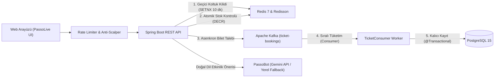

<div align="center">

# ✦ PassoLive — High-Concurrency Ticketing Platform

**Yüksek eşzamanlılıklı, olay güdümlü (Event-Driven) ve hologram tasarımlı modern dijital bilet satış platformu.**

[](https://openjdk.org/)
[](https://spring.io/projects/spring-boot)
[](https://redis.io/)
[](https://kafka.apache.org/)
[](https://www.postgresql.org/)
[](https://www.docker.com/)

</div>

---

## 📌 Proje Özeti

**PassoLive**, binlerce kullanıcının aynı saniyede popüler konser, festival, derbi veya tiyatro bileti almaya çalıştığı (*flash sale* / yüksek trafik) senaryolarda **çifte satışı (overselling)** ve **veritabanı kilitlenmelerini (lock contention)** tamamen önlemek için tasarlanmış uçtan uca bir biletleme platformudur.

Arka uçta **Redis Atomik Kapasite & Geçici Koltuk Kilidi**, **Apache Kafka Asenkron Kuyruğu**, **PostgreSQL**, **Hız Sınırlayıcı (Rate Limiter)**, **Davranışsal Güvenlik Motoru (Anti-Scalper)** ve **PassoBot Akıllı Bilet Asistanı** birlikte çalışır. Ön yüzde ise teknik jargondan tamamen arındırılmış, **bordo–krem hologram estetiğine** sahip, **Koyu & Aydınlık tema** destekli tam genişlikte bir son kullanıcı arayüzü sunar.

---

## 🏗️ Sistem Mimarisi (High-Concurrency Flow)

Geleneksel mimarilerde tüm bilet isteklerinin doğrudan ilişkisel veritabanına yönlendirilmesi yoğun trafikte `Deadlock` ve performans çöküşlerine yol açar. PassoLive bu problemi çok katmanlı bir akışla çözer:



### Mimari Katmanlar
1. **Hız Sınırlama & Güvenlik Katmanı:** `RateLimiterInterceptor` ve `AntiScalperService`, milisaniyelik anormal seri istekleri ve şüpheli toplu koltuk kapatma davranışlarını risk puanlamasıyla tespit ederek gerçek kullanıcıları korur.
2. **10 Dakikalık Geçici Koltuk Kilidi (`SETNX` + TTL):** Kullanıcı koltuk seçip ödemeye geçtiğinde koltuk Redis üzerinde atomik olarak **10 dakika** boyunca kilitlenir; istenirse `+3 dakika` uzatılabilir. Süre dolduğunda kilit otomatik serbest kalır.
3. **Redis Fail-Fast Kapasite Kapısı (`DECR`):** Stok tükendiğinde istek veritabanına hiç ulaşmadan bellek içinde reddedilir; sıfır çakışma (zero race condition) sağlanır.
4. **Apache Kafka Asenkron İşleme:** Onaylanan bilet talepleri `ticket-bookings` konusuna (topic) aktarılır. `TicketConsumer` talepleri sırayla tüketerek PostgreSQL'e yazar ve ani trafik sıçramalarını sönümler.
5. **PassoBot Akıllı Bilet Asistanı:** Canlı etkinlik kataloğunu okuyarak kategori, şehir ve bütçeye göre öneri sunar. Google Gemini API anahtarı tanımlıysa üretken modelle, anahtar yoksa kesintisiz çalışan yerel Türkçe eşleştirme motoruyla yanıt verir.

---

## ✨ Öne Çıkan Özellikler

### 🎨 Arayüz & Kullanıcı Deneyimi
- **Bordo–Krem Hologram Tasarım & Çift Tema:** Sıcak kadife bordo (Koyu Tema) ve sıcak krem–gül (Aydınlık Tema) arasında tek tıkla geçiş; akan hologram aurora dalgaları, ince poster dokusu (`grain`), 4 köşeli yıldız ışıltıları (`✦`) ve tam genişlikte (*edge-to-edge*) düzen.
- **Üst Menüde 1 Yıllık İnteraktif Takvim:** Sağ üstteki `📅 Takvim` butonuyla açılan, 12 ay boyunca ay ay gezilebilen Türkçe takvim. Etkinlik olan günleri ışıltılı noktalarla işaretler, seçilen tarihin **hangi güne denk geldiğini** gösterir ve tek tıkla o ayın etkinliklerini filtreler.
- **40 Özgün Etkinlik & Sürekli Güncel Tarihler:** Müzik & Konser, Festival & DJ, Spor ve Komedi & Tiyatro kategorilerinde her biri kendi türüne uygun **40 benzersiz görsel** ve bugünün tarihine göre **önümüzdeki 12 aya otomatik yayılan güncel etkinlik tarihleri**.
- **Gelişmiş Arama & Filtreleme:** Metin arama, şehir, önümüzdeki 12 aya dinamik tarih filtresi, maksimum fiyat, sıralama ve trend kaydırıcı (*carousel*).
- **Hesap Bazlı Favoriler & Bilet Alarmı:** Favoriler her kullanıcı hesabına özel saklanır; oturum kapatıldığında temizlenir. Biletleri tükenen etkinlikler için bildirim alarmı kurulabilir.

### 🎟️ Bilet Seçimi, Ödeme & Dijital Bilet
- **İnteraktif Salon Haritası & Yan Yana Koltuk Bulucu:** VIP (`1.8x`), Saha İçi (`1.2x`) ve Tribün (`0.8x`) blokları, dinamik 4x10 koltuk matrisi ve tek tıkla **2 veya 3 yan yana boş koltuk** seçimi.
- **Sahne Görüş Açısı Önizlemesi:** Seçilen kategoriye göre güncellenen sahne bakış açısı görselleri ve yakınlaştırma desteği.
- **10 Dakikalık Canlı Geri Sayım & `+3 Dk` Uzatma:** Ödeme süresince üst barda canlı sayaç.
- **SMS Doğrulama & Yazdırılabilir QR Dijital Bilet:** Sanal kart önizlemeli ödeme ekranı, 6 haneli tek kullanımlık SMS doğrulaması, PNR kodlu taranabilir **QR bilet** ve yazdırılabilir **PDF dijital giriş belgesi**.

### 🔐 Hesap Güvenliği & Yönetim
- **Canlı Şifre Gücü Göstergesi:** Hem **Kayıt Ol** hem **Profil Düzenleme** formlarında 4 kademeli (**Zayıf / Orta / İyi / Güçlü**) canlı güç çubuğu ve 4 maddelik anlık kural kontrol listesi.
- **Kullanıcı Paneli:** Onay bekleyen biletler, onaylanmış QR biletler, profil düzenleme ve ayarlar.
- **Yönetici Paneli & Güvenlik Merkezi:** Canlı ciro/satış özeti, kategori dağılımı, yeni etkinlik yayınlama formu ve şüpheli işlem izleme / güvenlik testi ekranı.

---

## 🛠️ Teknoloji Yığını

| Katman | Teknolojiler |
| --- | --- |
| **Backend** | Java 17, Spring Boot 3.3.3, Spring Web, Spring Data JPA, Spring Data Redis, Spring Kafka, Lombok |
| **Dağıtık Kilit & Önbellek** | Redis 7 (`alpine`), Redisson 3.35.0 |
| **Mesaj Kuyruğu** | Apache Kafka (`confluentinc/cp-kafka:7.5.0`), Zookeeper |
| **Veritabanı** | PostgreSQL 15 (`alpine`) |
| **Yapay Zeka / Asistan** | Google Gemini API (HTTP Client) + Yerel Türkçe Kural Tabanlı Fallback |
| **Frontend** | HTML5, Modern CSS3 (Glassmorphism & Hologram Aurora), Vanilla ES6+ JavaScript, QRious, Canvas Confetti |
| **Altyapı** | Docker & Docker Compose, Maven Wrapper (`mvnw`) |

---

## 📂 Proje Dizin Yapısı

```text
High-Concurrency Ticketing/
├── docker-compose.yml                         # PostgreSQL, Redis, Kafka, Zookeeper servisleri
├── pom.xml                                    # Maven bağımlılıkları (Spring Boot 3.3.3, Java 17)
├── mvnw / mvnw.cmd                            # Maven Wrapper
└── src/main/
    ├── java/com/ticketing/
    │   ├── TicketingApplication.java          # Spring Boot başlangıç sınıfı
    │   ├── config/
    │   │   ├── DataInitializer.java           # 40 özgün etkinlik & güncel 12 aylık tarih senkronizasyonu
    │   │   ├── RateLimiterInterceptor.java    # İstek hızı sınırlayıcı
    │   │   ├── RedissonConfig.java            # Dağıtık kilit yapılandırması
    │   │   └── WebMvcConfig.java              # Interceptor kayıtları
    │   ├── controller/                        # REST API uç noktaları (7 controller)
    │   ├── service/                           # Ticket, Event, Auth, User, AiChat, AntiScalper servisleri
    │   ├── consumer/
    │   │   └── TicketConsumer.java            # Kafka 'ticket-bookings' tüketicisi
    │   ├── entity/                            # Event, Ticket, User JPA varlıkları
    │   ├── repository/                        # Spring Data JPA depoları
    │   └── dto/                               # İstek / yanıt veri aktarım nesneleri
    └── resources/
        ├── application.properties             # DB, Redis, Kafka ve opsiyonel Gemini ayarları
        └── static/
            └── index.html                     # PassoLive tek sayfa web arayüzü
```

---

## 🚀 Kurulum ve Çalıştırma

### Ön Gereksinimler
- **Docker Desktop** (çalışır durumda)
- **Java 17** veya üzeri
- **Git**

### 1. Projeyi Klonlayın
```bash
git clone https://github.com/iamhilals/high-concurrency-ticketing.git
cd high-concurrency-ticketing
```

### 2. Altyapı Servislerini Başlatın (Docker)
PostgreSQL (`5432`), Redis (`6379`), Zookeeper (`2181`) ve Kafka (`9092`) servislerini ayağa kaldırın:

```bash
docker compose up -d
```

Servislerin hazır olduğunu doğrulayın:
```bash
docker compose ps
```

### 3. Spring Boot Uygulamasını Çalıştırın

**Windows (PowerShell / VS Code Terminal):**
```powershell
.\mvnw.cmd spring-boot:run
```

**macOS / Linux:**
```bash
./mvnw spring-boot:run
```

*(Opsiyonel)* PassoBot'ta Google Gemini desteğini aktif etmek için `src/main/resources/application.properties` dosyasında veya ortam değişkeninde `gemini.api.key` değerini tanımlayabilirsiniz. Tanımlanmazsa yerel Türkçe akıllı asistan otomatik devreye girer.

### 4. Uygulamayı Açın
Tarayıcınızdan şu adrese gidin:

👉 **http://localhost:8080**

> **Hazır Test Hesabı:** `DataInitializer` ilk açılışta örnek kullanıcı (`johndoe` / `password123`) ve önümüzdeki 12 aya yayılmış 40 benzersiz etkinliği otomatik olarak yükler ve kapasiteleri Redis ile eşitler.

---

## 🔌 REST API Uç Noktaları

### Kimlik Doğrulama & Kullanıcı
| Metot | Uç Nokta | Açıklama |
| --- | --- | --- |
| `POST` | `/api/auth/register` | Yeni kullanıcı kaydı oluşturur |
| `POST` | `/api/auth/login` | Kullanıcı adı veya e-posta ile giriş yapar |
| `PUT` | `/api/users/{userId}` | Kullanıcı profil bilgilerini ve şifresini günceller |

### Etkinlikler
| Metot | Uç Nokta | Açıklama |
| --- | --- | --- |
| `GET` | `/api/events` | Tüm etkinlikleri, tarihlerini ve kalan kapasitelerini listeler |
| `POST` | `/api/events` | Yönetici panelinden yeni etkinlik oluşturur ve Redis stoğunu eşitler |

### Bilet Rezervasyon & Satın Alma
| Metot | Uç Nokta | Açıklama |
| --- | --- | --- |
| `POST` | `/api/tickets/reserve` | Koltuğu Redis üzerinde 10 dakikalığına atomik olarak kilitler (`SETNX`) |
| `POST` | `/api/tickets/extend-lock` | Aktif koltuk rezervasyon süresini `+3 dakika` uzatır |
| `POST` | `/api/tickets/confirm` | Ödeme sonrası rezervasyonu kesinleştirir ve Kafka kuyruğuna iletir |
| `POST` | `/api/tickets` | Doğrudan bilet talebi (`Redis DECR` + `Kafka`) |
| `GET` | `/api/tickets/user/{userId}` | Kullanıcının onaylanmış bilet geçmişini döner |

### Akıllı Asistan & Güvenlik Merkezi
| Metot | Uç Nokta | Açıklama |
| --- | --- | --- |
| `POST` | `/api/ai/chat` | PassoBot bilet asistanı ile etkinlik arama & öneri sohbeti |
| `GET` | `/api/ai/anti-scalper/stats` | Anlık güvenlik analizi ve şüpheli işlem istatistikleri |
| `POST` | `/api/ai/anti-scalper/simulate-attack` | Yönetim paneli üzerinden güvenlik koruma testi başlatır |
| `POST` | `/api/ai/anti-scalper/toggle-defense` | Yüksek koruma modunu açar / kapatır |

---

## 📜 Lisans

Bu proje eğitim ve yüksek eşzamanlılıklı dağıtık sistem mimarisi gösterimi amacıyla geliştirilmiştir ve **MIT Lisansı** altındadır.
